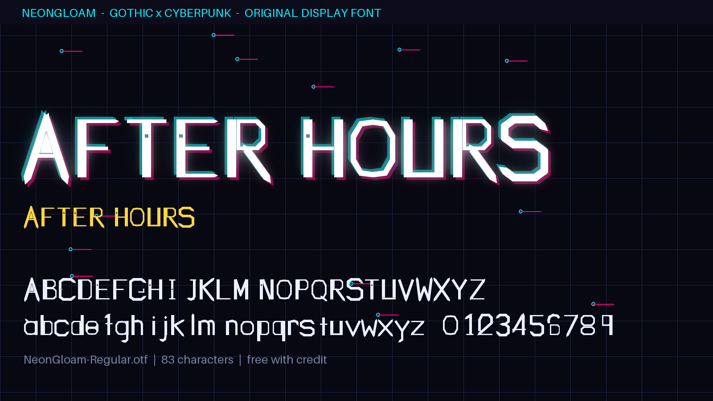
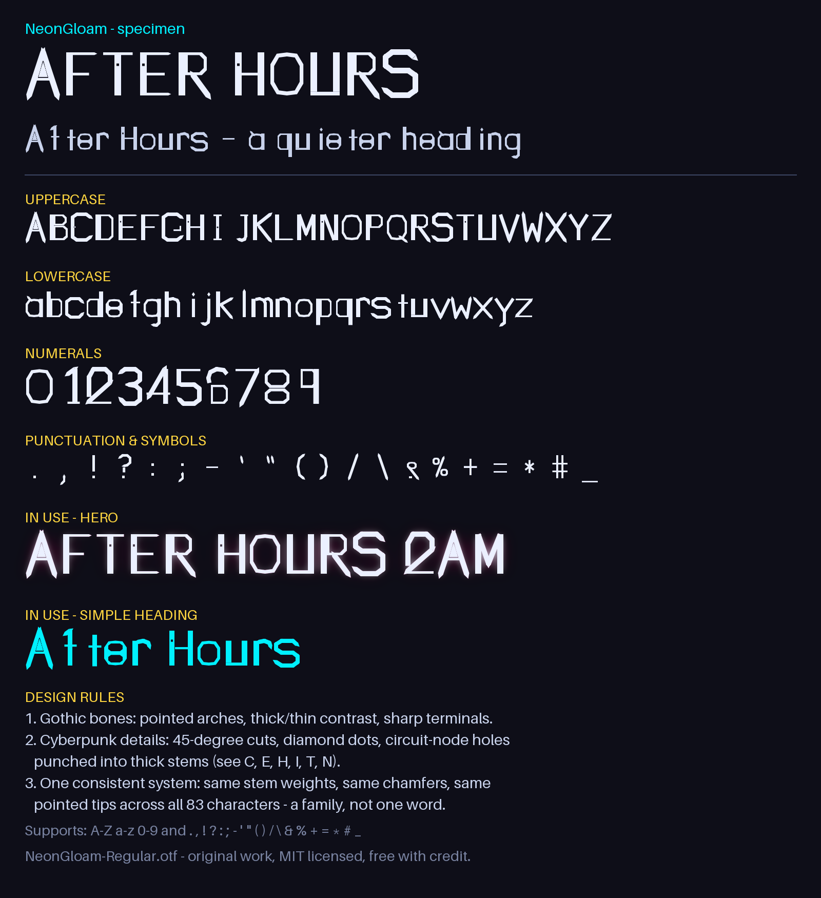

# NeonGloam

An original Latin display font that fuses **Gothic** bones with **cyberpunk** energy —
made for the Taskmarket bounty *"Font Gothic-Cyberpunk"* (TSK-1ZQ87Q8M).

## Download

- **Font:** [NeonGloam-Regular.otf](NeonGloam-Regular.otf) — install it and use it in any app.
- **Previews:** [preview-hero.png](preview-hero.png) · [preview-specimen.png](preview-specimen.png) · [preview-specimen.svg](preview-specimen.svg)

## Design

Gothic manuscript meets a hacked future city. Pointed arches, dramatic thick/thin
contrast and sharp terminals carry the blackletter skeleton, while 45-degree cuts,
diamond dots and small circuit-node holes punched into the thick stems bring the
neon-signage / circuitry energy — the same rules repeat across every letter, so it
reads as one family with a point of view, not a single decorated word. The hero
treatment goes full glitch-neon ("AFTER HOURS"), while the plain single-colour
setting works as a website heading.

## Characters supported (83)

- `A–Z`
- `a–z`
- `0–9`
- `. , ! ? : ; - ' " ( ) / \ & % + = * # _` and space

The font is complete for basic Latin display use. No other characters are included.

## Use

Install `NeonGloam-Regular.otf` like any font, then pick "NeonGloam" in your app
or reference it in CSS with `@font-face`. Free for personal and commercial use
with credit, under the MIT License (see [LICENSE](LICENSE)).

## Credits

Original design by Kuro / mikeytenji, 2026. Built programmatically with fontTools —
no existing typeface was traced or copied.
